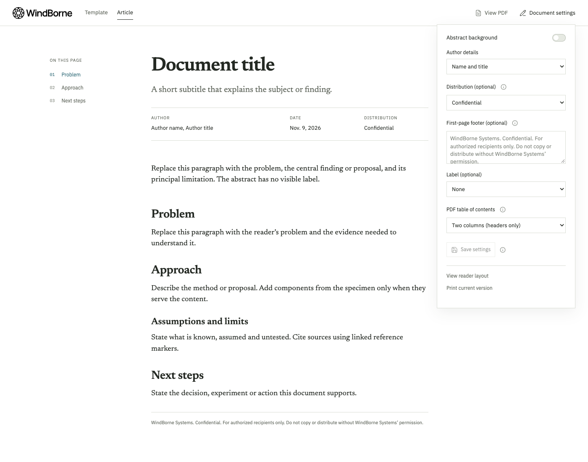

# WindBorne whitepaper template

A reusable editorial document system for technical papers, whitepapers and reports. Write once in HTML; read as a web article or export a paginated PDF with the same content. The approved design uses Newsreader prose/headings, IBM Plex Sans technical matter, IBM Plex Mono navigation/page numbers, and STIX Two Math.



## Start with your agent

Give your agent this repository and [AI-PROMPT.md](AI-PROMPT.md), plus your source text/files, title, authors and date. No prior knowledge of this project is needed. For example:

> Use https://github.com/windborne/whitepaper-template. Read README.md, SKILL.md and DESIGN.md, set up the local editor, and open the starter Article in draft mode. Use the attached content to create my paper. Keep the template defaults unless I specify otherwise. Save my chosen settings, generate a PDF, and give me the editable source and PDF after reviewing both.

The agent needs local file access and a terminal to install dependencies, edit HTML and run the server. **The browser is a layout/settings editor and preview, not a word processor.** Ask your agent to change the text, figures, author names or date in the HTML source; use Document settings to change their presentation.

## Install and open

Requires Git, Node.js 20+ and Python 3.10+. Run these commands in a terminal (macOS/Linux):

```sh
git clone https://github.com/windborne/whitepaper-template.git
cd whitepaper-template
npm ci
npx playwright install chromium
python3 -m venv .venv
.venv/bin/pip install -r requirements.txt
PYTHON=.venv/bin/python npm start
```

If you already cloned or downloaded the repository, start inside its folder and skip the first two commands. On Windows, use `.venv\Scripts\python.exe` for the virtual environment; in PowerShell set `$env:PYTHON=".venv\Scripts\python.exe"` before `npm start`. Install requirements with `.venv\Scripts\python.exe -m pip install -r requirements.txt`.

Open **[the draft editor](http://127.0.0.1:8743/article.html?mode=edit)**. Keep the terminal running while using Save settings or View PDF. To return another day, run `PYTHON=.venv/bin/python npm start` from the same folder; you do not need to reinstall.

- **Article** opens `article.html`, preloaded with starter copy on a fresh checkout. Your work stays in that file; reopening does not reset it.
- **Template** opens the component specimen. It is a reference you can browse while your agent builds your Article. Its settings belong to the specimen, not your paper.
- **Document settings** controls abstract shading, author details, category, distribution and PDF contents. Info icons explain the less obvious choices.

`CHROME` optionally selects an installed Chrome/Chromium executable; `PORT` changes the local port. Use the URL printed in the terminal if the port changes. Fonts and document assets are bundled; PDF export does not fetch external resources.

## Save, preview and export

| Action | What it does |
|---|---|
| **Save settings** | Writes the current choices into this document's HTML. The button is disabled until something changes; **Saved** confirms success. It does not edit article text or generate a PDF. |
| **View PDF** | Generates a PDF using the current choices, including unsaved ones, and opens it in a new viewer tab. Use the viewer's download/save control to keep a copy. |
| **View reader layout** | Opens a new tab with editing controls hidden and your current choices applied. Your original editing tab stays open. This is a local preview, not a published website. |
| **Print current version** | Opens browser print. Use View PDF for the finished export with resolved contents page numbers. |

Settings are **not autosaved**. Save before reloading or switching between Template and Article if you want to keep your changes. A reader preview carries a snapshot of the choices when opened; reopen it to see later changes. If another editor saved the same document, reload before choosing and saving again.

Generated PDF links are temporary: they expire after 30 minutes or a server restart. Download the PDF itself for sharing; a `127.0.0.1` link only works on your computer. Saving settings does not update existing PDFs. Generate a fresh PDF after changing content or settings.

## Author a document

1. For the first draft, edit `article.html`. Check for existing work before replacing it. For another paper, copy `starter.html` to a new root-level file such as `my-paper.html` (letters, numbers, hyphens or underscores; no spaces).
2. Replace the HTML `<title>`, visible title, subtitle, abbreviated date, abstract and article content. Update `document-config` authors and organization; its `defaults` hold saved presentation choices. Set `body data-document="my-paper"` to the filename without `.html`. The date is explicit source content, not automatically today's date.
3. Use stable unique IDs on `h2` and `h3` headings. Web navigation and PDF contents are generated from them. Copy figures, tables, equations and reference markup from `specimen.html` as needed, replacing illustrative content.
   For square or portrait photos, use the recommended 3in maximum with a right-side print caption; see [Photographs](DESIGN.md#photographs). Export logs flag untreated non-landscape images for review. Scientific charts, diagrams, maps and tables are exempt from photo limits.
4. Open `http://127.0.0.1:8743/my-paper.html?mode=edit`, adjust and save settings, then review the web article and View PDF. Template/Article tabs return to the same named draft. The shared CSS, JavaScript, fonts and referenced assets must remain alongside the source.

Recommended defaults: plain abstract, two-column PDF contents (headers only), author name and title, no optional label, Confidential. One-column contents includes headers and subheaders. PDF contents never appears in the web body and does not affect the web nav sidebar. See [DESIGN.md](DESIGN.md) for typography, options, footer language and page-flow rules. Confidential documents show the full notice at the bottom of the web article and on the first PDF page; later PDF pages use the short footer. Distribution markings do not provide access control.

`conop.html` is a worked example using supplied source material; its technical claims are not independently verified here. `stress-report.html` is a synthetic layout fixture, not research evidence. Keep both separate from your draft.

## Command-line export

```sh
PYTHON=.venv/bin/python node render.cjs my-paper.html my-paper.pdf
PYTHON=.venv/bin/python node render.cjs my-paper.html my-paper.pdf \
  --settings '{"contents":"one","category":"Field Brief","distribution":"Internal","details":"full","abstract":"shaded"}'
```

In Document settings, **Label (optional)** offers None, Category or Prepared for. Category reveals the existing category choices and Add new option; Prepared for reveals a free-text field with the placeholder “Conference/event name”. These share one header slot. Category appears in the footer; Prepared for does not. Both save and export with the document. For command-line export, use `--settings '{"label":"prepared-for","preparedFor":"AMS Annual Meeting 2027"}'`.

Omitted settings inherit the document's saved defaults. `npm run build` renders the working article, clean starter, specimen, CONOP and synthetic report. `./build.sh my-paper.html` is a compatibility wrapper. `npm run check` tests layout and interaction behavior; [VALIDATION.md](VALIDATION.md) describes PDF review and stress coverage.

The local server accepts only local, same-origin JSON export and settings-save requests for root-level HTML documents. Saving updates only the document configuration, preserves article content, and detects conflicting settings from another tab. Published reader files are read-only. It serves no arbitrary filesystem paths or repository secrets. It is an authoring utility, not a production hosting service.

## Publish a static reader

```sh
PYTHON=.venv/bin/python node publish.cjs my-paper.html dist/my-paper \
  --settings '{"distribution":"Public","category":"Research Paper"}'
```

This creates `dist/my-paper/my-paper.html`, `my-paper.pdf` and the shared assets. It does not upload anything. Open or host `my-paper.html` from that folder; the command does not create an `index.html`. Share the whole folder for a web reader, or just the PDF for a PDF handoff. The reader's View PDF opens that baked PDF; a static host cannot run Chromium to generate changed settings. Regenerate the package after content or settings change. The local editor provides live custom export; public static readers receive an exact fixed publication.

Directly opening an editable HTML file still lets you read it and use browser print, but saving settings and generating custom PDFs require `npm start`. Saving settings does not rebuild existing PDF files; View PDF generates the current version, and publishing packages the matching PDF. Browser-native print omits unresolved contents page numbers; use the renderer for a finished PDF. Editing controls are presentation state, not authentication.

## Contents of the repository

- `SKILL.md`, `AI-PROMPT.md`, `DESIGN.md`: reusable AI instructions and visual rules.
- `article.html`, `starter.html`, `specimen.html`, `conop.html`, `stress-report.html`: editable sources and companion PDFs.
- `style.css`, `fonts.css`, `controls.js`: shared design, offline fonts and interactions.
- `renderer.cjs`, `render.cjs`, `server.cjs`, `settings-store.cjs`, `publish.cjs`: deterministic PDF export, local editor and static packaging.
- `check.cjs`, `check-settings.cjs`, `check-help.cjs`, `check.py`, `VALIDATION.md`: behavioral checks, content checks and review guidance.
- `experiments/comparison`: preserved earlier design comparisons; `experiments/original`: original print-only template. `experiments/hybrid-v2` retains the design checkpoint. Start new work at the repository root.

Fonts carry their licenses in `licenses/`; Lucide's license is in `LICENSE-LUCIDE`. WindBorne's name and logo are brand assets, not a grant of trademark rights. Keep font and icon licenses with redistributed assets.
